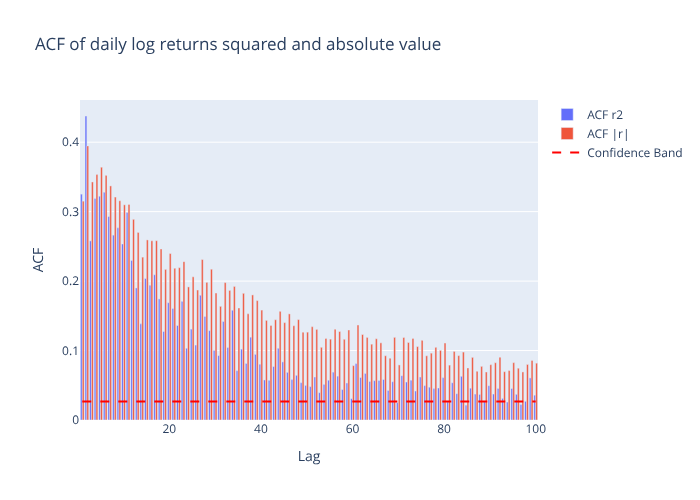
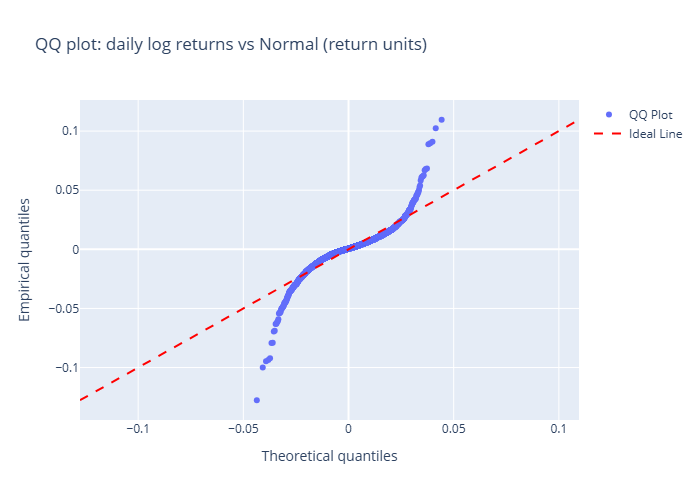
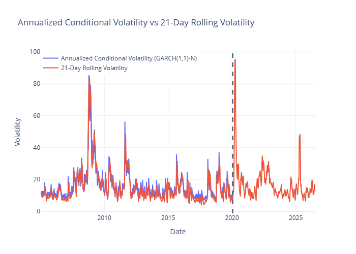

# Does GARCH(1,1) beat naive volatility forecasts out of sample?

One full turn of the volatility-research loop on ~20 years of S&P 500 daily
returns: verify the stylized facts, fit GARCH(1,1), produce one-day-ahead
variance forecasts on a 30% holdout with frozen parameters, and score them
against two naive benchmarks with a proxy-robust loss.

**Status: in progress.** <!-- Delete this line in roadmap box U4. -->

<!-- HOW TO USE THIS SKELETON
Each section carries a comment like this saying what belongs in it and which
ROADMAP.md box produces it. Write in your own voice: conclusion first,
numbers over adjectives, no "This project demonstrates..." — state findings,
not virtues. Delete every skeleton comment before pushing. -->

## TL;DR

<!-- U4. Paste the sober-conclusion paragraph from the last cell of
notebook 02, then compress it into 3–4 bullets, each carrying a NUMBER.
The expected honest shape (guide §5.2): GARCH beats the unconditional
benchmark decisively and beats yesterday's rolling vol modestly or not at
all at a one-day horizon. If that is what you find, say exactly that —
the sober version IS the credible result. -->

- _[QLIKE over the test period: GARCH-t … vs random walk … vs unconditional …]_
- _[Improvement vs unconditional: …% · vs random walk: …%]_
- _[Fitted persistence α+β = …, shock half-life ≈ … trading days]_
- _[One sentence on whether MSE agrees with the QLIKE ranking, and why that matters]_

## The question, and why it matters

<!-- S4. 3–5 sentences in your own words. Ingredients: the sign of
tomorrow's return is nearly unpredictable but its magnitude is strongly
predictable (the asymmetry the whole subject rests on); a volatility
forecast is a position size (size ∝ 1/σ̂), a risk limit, and to first order
an option price. Guide §0 if stuck. -->

## Data

<!-- S1. One short paragraph: ^GSPC daily, 2005–present, ADJUSTED close via
yfinance — one line on why adjusted and on the auto_adjust pin (the comments
in src/garch_lab/data.py have the story); trading-day calendar, no
reindexing to calendar days; prices cached locally under data/, not
committed. -->

## What the data demand of a model

<!-- S4. One short paragraph per verified stylized fact, each anchored to a
number you computed in notebook 01: excess kurtosis (and its subsample
instability), the |r| > 4σ day count vs the Gaussian expectation, fitted
Student-t ν̂, lag-1 ACF of |r| and how far the significance extends, the
leverage correlation. End with the punchline: a model that cannot reproduce
clustering and fat tails is dead on arrival — which is the license for
GARCH. -->





## Model and evaluation design

<!-- U2/U3. Be precise, it is the section readers check: GARCH(1,1)
with Gaussian and Student-t innovations, fit by MLE on the first 70%
(chronological split at [date]); one-step-ahead variance forecasts over the
last 30% with parameters FROZEN at their train estimates (no refitting);
benchmarks = 21-day random-walk variance and unconditional train variance;
proxy = squared daily return; QLIKE primary and MSE secondary, with one
sentence on Patton (2011) — under a noisy proxy, most intuitive losses can
systematically misrank models; these two cannot. Disclose the zero-return-
day count and your drop-vs-clip decision here. -->

## Results

<!-- U4. The loss table plus ONE interpretation paragraph. State the units
(daily variance, %² per day) next to the table. -->

| Forecast | QLIKE | MSE |
|---|---|---|
| GARCH(1,1)-t | _…_ | _…_ |
| GARCH(1,1)-N | _…_ | _…_ |
| Random walk (21d) | _…_ | _…_ |
| Unconditional (train) | _…_ | _…_ |



<!-- There is deliberately NO forecast-vs-realized scatter here: the daily
squared-return proxy carries noise ≈ 141% of its signal (guide §3.3), so
that picture is uninformative by construction. Say that in one sentence —
it is worth more than the plot. -->

## Limitations, and what I would do next

<!-- U4. Honest list, one line each, every item tied to something you
MEASURED: leverage effect present in the data but GARCH(1,1) is sign-blind
→ GJR/EGARCH; empirical ACF of |r| decays slower than any exponential →
HAR-RV; a single 70/30 split with frozen parameters → walk-forward
re-estimation; the QLIKE gap has no significance attached → Diebold–Mariano;
zero-return-day handling. -->

## Reproduce it

```
python -m venv .venv
.venv\Scripts\python.exe -m pip install -e ".[dev]"
.venv\Scripts\python.exe -m pytest          # the suite specifies the library functions
.venv\Scripts\python.exe -m jupyter lab     # run notebooks/01, then notebooks/02
```

<!-- Windows note to keep: if PowerShell blocks .venv activation (execution
policy), don't fight it — call .venv\Scripts\python.exe directly, as above.
Mention that requirements.txt is a pip-freeze snapshot of the environment
that produced the results (you create it in U4). -->

## References

Cont (2001) — stylized facts. Engle (1982) — ARCH. Bollerslev (1986) —
GARCH(1,1). Patton (2011) — loss functions under imperfect volatility
proxies. Annotated list and the full conceptual companion:
[docs/concept-guide.md](docs/concept-guide.md).
